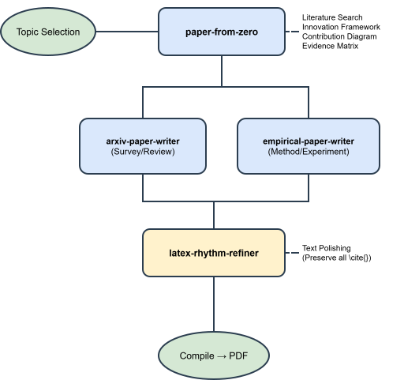
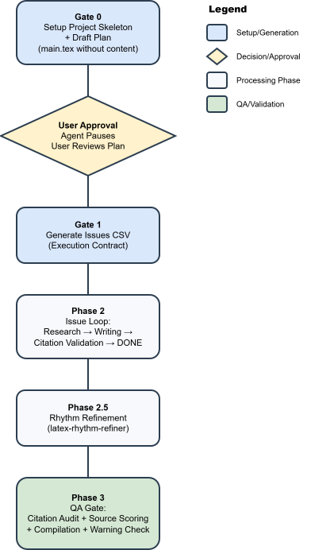

# latex-paper-skills

New: [Beginner Workflow Guide (Chinese)](BEGINNER_WORKFLOW.zh-CN.md)

English | [简体中文](README.zh-CN.md)

> Portable **AI agent skill bundle** for writing ML/AI academic papers —
> from topic to compiled PDF, with verified BibTeX citations, gated
> workflows, and multi-agent collaboration.

## What This Repo Is

This repository is not a single paper project. It is a reusable skill bundle for AI-assisted academic writing.

In this public snapshot, the repo keeps:

- the reusable writing skills under `.codex/skills/`
- the repo-level workflow and documentation
- two curated showcase projects: one empirical and one review

The repo intentionally does **not** keep bulky local datasets, machine-local settings, or cache databases. For the empirical showcase, the raw dataset used during development has been removed, but the retained code, result files, figures, and final PDF still show that the workflow completed a real data-and-experiment loop.

## Status & Tested Models

The showcases in this repo were developed and tested with **GPT-5.2 xhigh**. Using **GPT-5.4** is expected to yield better results. Test coverage is still limited — the workflow has significant untapped potential, though undiscovered bugs may exist.

## How It Works

<p align="center">
  
</p>

**Optional multi-agent collaboration:**

| Agent | Role | Tool |
|-------|------|------|
| Gemini | Breadth — literature expansion, keyword clusters, alternative framings | `gemini_bridge.py` |
| Claude | Depth — claim stress-testing, evidence audit, routing judgment | `claude_bridge.py` |
| Health check | Verify both CLIs are installed and API-reachable | `check-collaborators` |

## Skill Catalog

The eight source skills live under `.codex/skills/`. Each has a `SKILL.md` (the executable spec an agent follows), plus optional `scripts/`, `assets/`, and `references/`. The installer exposes one `latex-paper-skills` entry containing all eight workflows and their resources.

### Core Pipeline

| Skill | What it does |
|-------|-------------|
| **paper-from-zero** | Router. Topic → literature search → innovation framing → contribution map → evidence matrix → route to writer. |
| **arxiv-paper-writer** | Review/survey executor. Gated IEEEtran LaTeX workflow with issues CSV contract, per-issue writing loop, citation verification, and QA. |
| **empirical-paper-writer** | Experimental paper executor. Extends the review workflow with experiment matrices, result status tracking (`planned`/`placeholder`/`verified`), and evidence-claim mapping. |
| **latex-rhythm-refiner** | Prose polisher. Varies sentence/paragraph rhythm, removes filler, strictly preserves all `\cite{}` positions. |
| **results-backfill** | Back-fills real experiment results into an existing draft. Resolves placeholders, upgrades hypotheses to factual claims, generates figures. |

### Collaboration Layer

| Skill | What it does |
|-------|-------------|
| **collaborating-with-gemini** | Breadth co-pilot via Gemini CLI. Structured JSON + session persistence. |
| **collaborating-with-claude** | Depth co-pilot via Claude Code CLI. Claim stress-testing and evidence audit. |
| **check-collaborators** | Health check — verifies CLI installation, auth, and API reachability. |

## Gated Workflow

Both writer skills enforce strict gates:

<p align="center">
  
</p>

## Quick Start

### Install from npm (recommended)

The package is published on [npm](https://www.npmjs.com/package/latex-paper-skills)
as **`latex-paper-skills@0.1.0`**, owned by `yunshenwuchuxun`. With **Node.js
22.20.0 or newer**, run this from your paper project:

```bash
npx latex-paper-skills@latest --agent codex --copy --yes
```

This installs the complete bundle for Codex in the current project. Replace
`--agent codex` with `--agent claude-code` to use Claude Code. Then ask:
`Use latex-paper-skills. My topic is: <your topic>`.
Users do not need an npm account.

To pin the published version or inspect the package:

```bash
npx latex-paper-skills@0.1.0 --agent codex --copy --yes
npx latex-paper-skills@latest --version
npx latex-paper-skills@latest list
```

For an optional user-level installation, add `--global` explicitly:

```bash
npx latex-paper-skills@latest --agent codex --copy --yes --global
```

The npm command uses the [Skills CLI](https://github.com/vercel-labs/skills)
with the complete bundle already included in the npm package. It preserves all
shared dependencies and has no install lifecycle hooks.

### Install from GitHub with the Skills CLI

The existing GitHub installation remains available:

```bash
npx skills@latest add yunshenwuchuxun/latex-paper-skills --skill latex-paper-skills --agent codex --copy --yes
```

The installable directory is `skills/latex-paper-skills/`. It includes all eight
workflows, `_shared`, scripts, and templates. Install this complete package;
installing individual source folders under `.codex/skills/` omits their shared
dependencies.

### Published packages and downloads

- [ClawHub bundle](https://clawhub.ai/yunshenwuchuxun/plugins/latex-paper-skills):
  version **0.1.0**, install with
  `openclaw plugins install clawhub:@yunshenwuchuxun/latex-paper-skills@0.1.0`.
- [LobeHub skill](https://lobehub.com/skills/yunshenwuchuxun-latex-paper-skills):
  open the listing for its installation or bundle download options. The
  marketplace listing version is **1.0.2**; its complete source bundle is
  **0.1.0**. These are separate version numbers.
- [GitHub release v0.1.0](https://github.com/yunshenwuchuxun/latex-paper-skills/releases/tag/v0.1.0):
  [download the complete skill ZIP](https://github.com/yunshenwuchuxun/latex-paper-skills/releases/download/v0.1.0/latex-paper-skills-0.1.0.zip).

All these distributions contain the complete suite. See
[distribution and publishing](distribution/README.md) for format and license
details.

### Prerequisites

- Node.js 22.20.0+ for the npm installer
- Python 3.10+ for the paper workflow scripts
- LaTeX environment (`pdflatex` + `bibtex`, or `latexmk`) to compile PDFs
- AI agent runtime that reads `SKILL.md` (Codex CLI, Claude Code, etc.)

Node.js runs the installer. The paper workflows still need their Python and
LaTeX environments, along with any dependencies required by your experiments.
Optional collaboration also requires installed, authenticated Gemini and Claude
CLIs.

### Full pipeline (topic → PDF)

```text
Use the paper-from-zero skill. My topic is: <your topic>
```

### Direct review paper

```text
Use the arxiv-paper-writer skill. Write a review article about <topic>.
```

### Direct empirical paper

```text
Use the empirical-paper-writer skill. Write an experimental paper about <topic>.
```

### Prompt templates: specify datasets and cloud execution

You can specify datasets, runtime budget, and an intended cloud platform directly in natural language.

```text
Use the empirical-paper-writer skill.
Topic: <topic>.
Mandatory datasets: <Dataset A>, <Dataset B>.
Primary dataset: <Dataset A>.
Do not use private data.
Design a compute-aware experiment plan for a single A100 80GB.
```

```text
Use the empirical-paper-writer skill.
Topic: <topic>.
Dataset: <dataset name> from local path <path>.
Target runtime: cloud A100 x1, max 8 hours.
Need a local smoke run first, then a full cloud run.
Keep the claims bounded by this compute budget.
```

```text
Use the empirical-paper-writer skill.
Topic: <topic>.
Mandatory datasets: <dataset names>.
Target platform: AutoDL / Lambda / Slurm cluster.
Generate experiments/, configs/default.yaml, and an experiments README for cloud execution.
Assume I will run the jobs myself and then use results-backfill after real CSVs are available.
```

Notes:
- The skill can design for your dataset and cloud budget.
- The skill does not automatically provision or submit cloud jobs for you.
- Real results still need to be produced outside the AI session and written to `paper/results/`.

## Shared Script Engine

`.codex/skills/arxiv-paper-writer/scripts/` contains the core tooling shared by both writers:

| Script | Purpose |
|--------|---------|
| `arxiv_registry.py` | arXiv metadata/BibTeX cache (SQLite) |
| `compile_paper.py` | LaTeX compilation (latexmk or pdflatex+bibtex) |
| `citation_policy.py` | Citation audit (bib/tex consistency, lint) |
| `source_ranker.py` | Source quality scoring |
| `style_profile.py` | Target venue style checking |
| `issue_workflow.py` | Issue execution helpers |
| `bootstrap_ieee_review_paper.py` | Scaffold IEEEtran project skeleton |
| `create_paper_plan.py` | Generate paper plan from outline |
| `validate_paper_issues.py` | Validate issues CSV integrity |

Shared utilities (`paper_utils.py`, `source_policy_utils.py`) live in `.codex/skills/_shared/`.

## Non-Negotiable Rules

- **No prose before approval** — `main.tex` stays skeleton-only until the plan is approved and the issues CSV exists.
- **Issues CSV is the contract** — update status per issue; only mark `DONE` when acceptance criteria are met.
- **Citations must be verified** — every citation is checked against an online source before entering `ref.bib`.
- **Never fabricate** citations, results, or significance claims.

## Public Showcases

This public snapshot keeps two curated showcase projects:

| Project | Type | What it demonstrates | Start here |
|--------|------|----------------------|------------|
| `projects/rt-inflow-forecast-closed-loop` | Empirical paper | Topic framing, experiment design artifacts, local dataset integration, verified result files, figures, and back-filled paper writing | `README.md`, `paper/main.pdf`, `paper/results/`, `experiments/README.md` |
| `projects/peft-survey-2022-2026` | Review paper | Topic framing, outline/plan approval, issues-driven writing, literature organization, citation-verified review drafting, and final paper | `README.md`, `main.pdf`, `plan/`, `issues/` |

If you only want the fastest tour:

1. Open `projects/rt-inflow-forecast-closed-loop/README.md` for the empirical route.
2. Open `projects/peft-survey-2022-2026/README.md` for the review route.
3. Read `BEGINNER_WORKFLOW.zh-CN.md` if you want the end-to-end workflow explanation in Chinese.

## Project Structure

```
latex-paper-skills/
├── .codex/skills/
│   ├── paper-from-zero/              # Router: topic → writer skill
│   ├── arxiv-paper-writer/           # Review paper executor + shared scripts
│   ├── empirical-paper-writer/       # Empirical paper executor
│   ├── results-backfill/             # Back-fill real results into draft
│   ├── latex-rhythm-refiner/         # Prose polisher
│   ├── collaborating-with-claude/    # Claude Code bridge
│   ├── collaborating-with-gemini/    # Gemini CLI bridge
│   ├── check-collaborators/          # CLI health check
│   ├── _shared/                      # Shared utilities across skills
│   └── _orchestration/               # Workflow orchestration config
├── skills/latex-paper-skills/        # Complete installable bundle
├── bin/latex-paper-skills.mjs        # npm installation command
├── package.json                     # npm metadata and installer dependency
├── distribution/                    # Publishing guide and package metadata
├── scripts/build_distribution.py    # Rebuild and verify distribution artifacts
├── projects/
│   ├── rt-inflow-forecast-closed-loop/  # Empirical showcase
│   └── peft-survey-2022-2026/           # Review showcase
├── picture/                          # SVG diagrams for README
├── ARCHITECTURE.md                   # Detailed architecture analysis
├── BEGINNER_WORKFLOW.zh-CN.md        # Beginner workflow guide (Chinese)
├── README.md
└── README.zh-CN.md
```

## Distribution for Maintainers

Source development stays under `.codex/skills/`. Before a future release, choose
a new version and update the version fields described in the
[publishing guide](distribution/README.md#standalone-npm-package). From the
repository root, rebuild and verify the complete distribution, then prepare the
npm tarball:

```bash
npm ci
npm run build:distribution
npm run check:distribution
npm test
npm pack --pack-destination dist
npm publish --dry-run --access public
```

Review the package contents, authenticate as the intended publisher, and publish:

```bash
npm login --auth-type=web
npm whoami
npm publish --access public
```

Complete npm's browser 2FA verification when prompted. Version `0.1.0` is already
published; subsequent releases require a new version. Commit the rebuilt bundle
with its source changes so GitHub installers receive the same contents. See the
[distribution and publishing guide](distribution/README.md) for the GitHub
Release, ClawHub, and LobeHub workflows.

## Related

- Forked from [renocrypt/latex-arxiv-SKILL](https://github.com/renocrypt/latex-arxiv-SKILL)
- Workflow inspired by [appautomaton/agent-designer](https://github.com/appautomaton/agent-designer) (issue-driven development)
- Uses [IEEEtran](https://ctan.org/pkg/ieeetran) LaTeX class

## Star History

<p align="center">
  <a href="https://star-history.com/#yunshenwuchuxun/latex-paper-skills&Date">
    <picture>
      <source media="(prefers-color-scheme: dark)" srcset="https://api.star-history.com/image?repos=yunshenwuchuxun/latex-paper-skills&type=Date&theme=dark" />
      <source media="(prefers-color-scheme: light)" srcset="https://api.star-history.com/image?repos=yunshenwuchuxun/latex-paper-skills&type=Date" />
      
    </picture>
  </a>
</p>

## License

This repository is released under the [MIT License](LICENSE).

## Community

- [LinuxDO](https://linux.do/)
