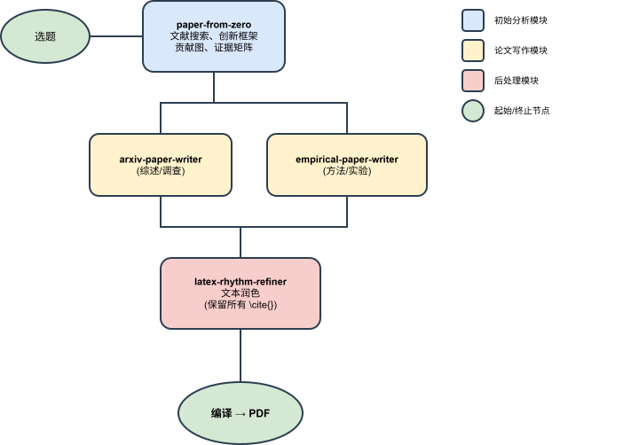
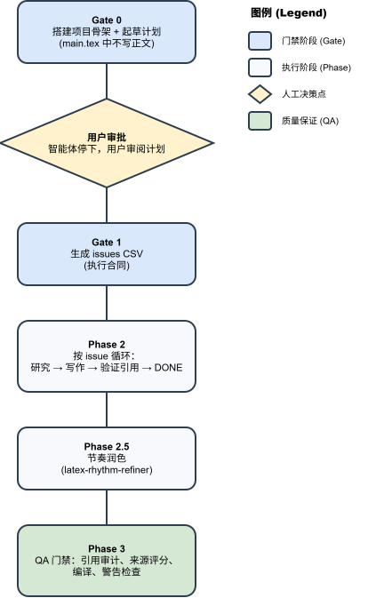

# latex-paper-skills

新手先看：[AI 写论文工作流入门](BEGINNER_WORKFLOW.zh-CN.md)

[English](README.md) | 简体中文

> 可移植的 **AI 智能体技能包**，用于撰写 ML/AI 学术论文 ——
> 从选题到编译 PDF，附带已验证的 BibTeX 引用、门禁工作流和多智能体协作。

## 这个仓库是什么

这个仓库不是某一篇论文的单独工程，而是一套可复用的 AI 学术写作技能包。

这份公开快照主要保留三类内容：

- `.codex/skills/` 下的可复用技能
- 仓库级工作流文档
- 两个精选 showcase：一个实证论文，一个综述论文

这份公开仓库刻意**不**保留大体积本地数据集、机器本地配置和缓存数据库。对实证 showcase 来说，开发阶段实际使用过的原始数据已经移除，但保留下来的代码、结果文件、图和最终 PDF 仍然能说明这个工作流真实完成了“找数据集 → 接入数据 → 运行实验 → 回填论文”的闭环。

## 状态与测试模型

本仓库的 showcase 使用 **GPT-5.2 xhigh** 开发和测试。使用 **GPT-5.4** 效果预计会更好。目前测试用例较少，工作流还有很大的提升空间，当然也不排除存在尚未发现的 bug。

## 工作原理

<p align="center">
  
</p>

**可选的多智能体协作：**

| 智能体 | 定位 | 工具 |
|--------|------|------|
| Gemini | 广度 — 文献扩展、关键词聚类、替代框架 | `gemini_bridge.py` |
| Claude | 深度 — 声明压测、证据审计、路由判断 | `claude_bridge.py` |
| 健康检查 | 验证两个 CLI 已安装且 API 可达 | `check-collaborators` |

## 技能一览

所有技能位于 `.codex/skills/`，每个技能包含 `SKILL.md`（智能体执行的可执行规范），以及可选的 `scripts/`、`assets/`、`references/`。

### 核心流水线

| 技能 | 功能 |
|------|------|
| **paper-from-zero** | 路由层。选题 → 文献搜索 → 创新框架 → 贡献图 → 证据矩阵 → 路由到写作技能。 |
| **arxiv-paper-writer** | 综述论文执行器。门禁 IEEEtran LaTeX 工作流，含 issues CSV 合同、按 issue 写作循环、引用验证和 QA。 |
| **empirical-paper-writer** | 实验论文执行器。在综述工作流基础上增加实验矩阵、结果状态追踪（`planned`/`placeholder`/`verified`）和证据-声明映射。 |
| **latex-rhythm-refiner** | 文本润色器。变化句段节奏、去除填充词，严格保持所有 `\cite{}` 位置不变。 |
| **results-backfill** | 将真实实验结果回填到现有草稿。替换占位符、将假设升级为事实性表述、生成结果图。 |

### 协作层

| 技能 | 功能 |
|------|------|
| **collaborating-with-gemini** | 广度协作者（Gemini CLI）。结构化 JSON + 会话持久化。 |
| **collaborating-with-claude** | 深度协作者（Claude Code CLI）。声明压测和证据审计。 |
| **check-collaborators** | 健康检查 — 验证 CLI 安装、认证和 API 可达性。 |

## 门禁工作流

两个写作技能都执行严格的门禁：

<p align="center">
  
</p>

## 快速开始

### 通过 npm / npx 安装（推荐）

[latex-paper-skills](https://www.npmjs.com/package/latex-paper-skills) 已发布到 npm，
当前版本为 **0.1.0**，发布账号为 `yunshenwuchuxun`。使用者无需 npm 账号。
安装器需要 **Node.js 22.20.0+**。

在论文项目目录中运行以下命令，将完整技能安装到当前项目的 Codex 环境：

```bash
npx latex-paper-skills@latest --agent codex --copy --yes
```

Claude Code 用户使用：

```bash
npx latex-paper-skills@latest --agent claude-code --copy --yes
```

`--copy` 将技能资源复制到项目中；`--yes` 跳过交互确认。省略 `--agent`
可交互选择智能体。若要安装到用户级技能目录，追加 `--global`：

```bash
npx latex-paper-skills@latest --agent codex --global --copy --yes
```

将 `@latest` 换成 `@0.1.0` 可固定版本。也可以查看版本和包含的技能入口：

```bash
npx latex-paper-skills@latest --version
npx latex-paper-skills@latest list
```

安装后可直接说：`Use latex-paper-skills. My topic is: <你的主题>`。
统一入口包含全部 8 个工作流、`_shared`、脚本和模板。

### 从 GitHub 安装

也可以通过 [Skills CLI](https://github.com/vercel-labs/skills) 从 GitHub
安装同一个完整技能包：

```bash
npx skills@latest add yunshenwuchuxun/latex-paper-skills --skill latex-paper-skills --agent codex --copy --yes
```

Claude Code 用户将 `--agent codex` 换成 `--agent claude-code`；用户级安装追加
`--global`。请使用统一入口 `latex-paper-skills`，以保留跨技能共享依赖。
开发源码位于 `.codex/skills/`，可安装的完整分发包位于
`skills/latex-paper-skills/`。

### 已发布渠道

| 渠道 | 当前版本 | 安装或下载 |
|------|----------|------------|
| [npm](https://www.npmjs.com/package/latex-paper-skills) | `0.1.0` | 使用上面的 `npx latex-paper-skills@latest` 命令 |
| [GitHub Releases](https://github.com/yunshenwuchuxun/latex-paper-skills/releases/tag/v0.1.0) | `v0.1.0` | [下载完整技能 ZIP](https://github.com/yunshenwuchuxun/latex-paper-skills/releases/download/v0.1.0/latex-paper-skills-0.1.0.zip) |
| [ClawHub / OpenClaw](https://clawhub.ai/yunshenwuchuxun/plugins/latex-paper-skills) | `0.1.0` | 安装完整插件包，命令见下方 |
| [LobeHub](https://lobehub.com/skills/yunshenwuchuxun-latex-paper-skills) | 平台 `1.0.2`，源码 `0.1.0` | 从技能页面安装或下载完整包 |

OpenClaw 用户可安装已发布的 ClawHub 插件包：

```bash
openclaw plugins install clawhub:@yunshenwuchuxun/latex-paper-skills@0.1.0
```

`clawhub:` 前缀指定 ClawHub 来源。各渠道均包含完整技能及第三方许可说明；
LobeHub 的平台版本号由平台分配，与 npm / 源码版本分别管理。

### 前置要求

- Node.js 22.20.0+（用于 npm / npx 安装器）
- Python 3.10+
- LaTeX 环境（`pdflatex` + `bibtex`，或 `latexmk`）
- 能读取 `SKILL.md` 的 AI 智能体运行时（Codex CLI、Claude Code 等）

安装器依赖 Node.js；运行论文脚本和编译 PDF 仍需 Python 与 LaTeX。
Gemini CLI 和 Claude Code CLI 仅在启用对应协作工作流时需要。

### 完整流水线（选题 → PDF）

```text
Use the paper-from-zero skill. My topic is: <你的研究主题>
```

### 直接写综述论文

```text
Use the arxiv-paper-writer skill. Write a review article about <主题>.
```

### 直接写实验论文

```text
Use the empirical-paper-writer skill. Write an experimental paper about <主题>.
```

### 调用模板：指定数据集与云平台运行

你可以在自然语言里直接指定数据集、算力预算和目标云平台。

```text
Use the empirical-paper-writer skill.
Topic: <主题>.
Mandatory datasets: <数据集 A>, <数据集 B>.
Primary dataset: <数据集 A>.
Do not use private data.
Design a compute-aware experiment plan for a single A100 80GB.
```

```text
Use the empirical-paper-writer skill.
Topic: <主题>.
Dataset: <数据集名称> from local path <路径>.
Target runtime: cloud A100 x1, max 8 hours.
Need a local smoke run first, then a full cloud run.
Keep the claims bounded by this compute budget.
```

```text
Use the empirical-paper-writer skill.
Topic: <主题>.
Mandatory datasets: <数据集名称>.
Target platform: AutoDL / Lambda / Slurm cluster.
Generate experiments/, configs/default.yaml, and an experiments README for cloud execution.
Assume I will run the jobs myself and then use results-backfill after real CSVs are available.
```

说明：
- 这个 skill 可以按你的数据集和算力预算来设计实验。
- 这个 skill 不会自动替你开云主机或提交云端任务。
- 真实结果仍然需要在 AI 会话外跑出，并写入 `paper/results/`。

## 共享脚本引擎

`.codex/skills/arxiv-paper-writer/scripts/` 包含两个写作技能共用的核心脚本：

| 脚本 | 用途 |
|------|------|
| `arxiv_registry.py` | arXiv 元数据/BibTeX 缓存（SQLite） |
| `compile_paper.py` | LaTeX 编译（latexmk 或 pdflatex+bibtex） |
| `citation_policy.py` | 引用审计（bib/tex 一致性、lint） |
| `source_ranker.py` | 来源质量评分 |
| `style_profile.py` | 目标期刊/会议风格检查 |
| `issue_workflow.py` | Issue 执行辅助 |
| `bootstrap_ieee_review_paper.py` | 搭建 IEEEtran 项目骨架 |
| `create_paper_plan.py` | 从大纲生成论文计划 |
| `validate_paper_issues.py` | 校验 issues CSV 完整性 |

跨技能共享工具（`paper_utils.py`、`source_policy_utils.py`）位于 `.codex/skills/_shared/`。

## 不可违反的规则

- **审批前不写正文** — `main.tex` 在计划获批且 issues CSV 存在前只保留骨架。
- **Issues CSV 是合同** — 按 issue 更新状态；仅在满足验收标准时标记 `DONE`。
- **引用必须验证** — 每条引用在写入 `ref.bib` 前都要通过在线来源核实。
- **严禁捏造** 引用、结果或显著性声明。

## 公开 Showcase

这份公开仓库只保留两个精选项目：

| 项目 | 类型 | 它展示了什么 | 建议先看 |
|------|------|--------------|----------|
| `projects/rt-inflow-forecast-closed-loop` | 实证论文 | 选题框架、实验设计工件、本地数据集接入、已验证结果文件、结果图，以及回填后的论文 | `README.md`、`paper/main.pdf`、`paper/results/`、`experiments/README.md` |
| `projects/peft-survey-2022-2026` | 综述论文 | 选题框架、plan 审批、issues 驱动写作、文献组织、引用核验后的综述草稿与最终论文 | `README.md`、`main.pdf`、`plan/`、`issues/` |

如果你只想最快看明白：

1. 先看 `projects/rt-inflow-forecast-closed-loop/README.md`，理解实证路线。
2. 再看 `projects/peft-survey-2022-2026/README.md`，理解综述路线。
3. 想看完整工作流解释，再读 `BEGINNER_WORKFLOW.zh-CN.md`。

## 项目结构

```
latex-paper-skills/
├── .codex/skills/
│   ├── paper-from-zero/              # 路由层：选题 → 写作技能
│   ├── arxiv-paper-writer/           # 综述论文执行器 + 共享脚本
│   ├── empirical-paper-writer/       # 实验论文执行器
│   ├── results-backfill/             # 将真实结果回填到草稿
│   ├── latex-rhythm-refiner/         # 文本润色器
│   ├── collaborating-with-claude/    # Claude Code 桥接
│   ├── collaborating-with-gemini/    # Gemini CLI 桥接
│   ├── check-collaborators/          # CLI 健康检查
│   ├── _shared/                      # 跨技能共享工具
│   └── _orchestration/               # 工作流编排配置
├── skills/latex-paper-skills/        # 可安装的完整技能包
├── bin/latex-paper-skills.mjs        # npm / npx 安装命令
├── distribution/README.md            # 各平台分发与发布指南
├── scripts/build_distribution.py    # 生成 ZIP、技能包和 ClawHub 插件包
├── package.json                     # npm 元数据、依赖和打包范围
├── projects/
│   ├── rt-inflow-forecast-closed-loop/  # 实证论文 showcase
│   └── peft-survey-2022-2026/           # 综述论文 showcase
├── picture/                          # README 用 SVG 图表
├── ARCHITECTURE.md                   # 详细架构分析
├── BEGINNER_WORKFLOW.zh-CN.md        # 工作流入门指南
├── README.md
└── README.zh-CN.md
```

## 维护者：构建与发布

修改 `.codex/skills/` 中的源码后，需要重新生成完整分发包。发布后续版本前，
先按[分发与发布说明](distribution/README.md#standalone-npm-package)同步版本号，
再在仓库根目录运行：

```bash
npm ci
npm run build:distribution
npm run check:distribution
npm test
npm pack --pack-destination dist
npm publish --dry-run --access public
```

确认发行包内容后，用维护者账号登录并发布：

```bash
npm login --auth-type=web
npm whoami
npm publish --access public
```

npm 发布需要账号启用 2FA，并在 CLI 提供的 npm 官方页面完成发布验证。
当前 `0.1.0` 已发布；后续发布需使用新的版本号，并提交生成的
`skills/latex-paper-skills/`，让 GitHub 安装渠道与发行包保持一致。
GitHub Releases、ClawHub 和 LobeHub 的发布流程详见
[分发与发布说明](distribution/README.md)。

## 相关

- 基于 [renocrypt/latex-arxiv-SKILL](https://github.com/renocrypt/latex-arxiv-SKILL) 修改而来
- 工作流受 [appautomaton/agent-designer](https://github.com/appautomaton/agent-designer) 启发（issue-driven development）
- 使用 [IEEEtran](https://ctan.org/pkg/ieeetran) LaTeX 文档类

## Star History

<p align="center">
  <a href="https://star-history.com/#yunshenwuchuxun/latex-paper-skills&Date">
    <picture>
      <source media="(prefers-color-scheme: dark)" srcset="https://api.star-history.com/image?repos=yunshenwuchuxun/latex-paper-skills&type=Date&theme=dark" />
      <source media="(prefers-color-scheme: light)" srcset="https://api.star-history.com/image?repos=yunshenwuchuxun/latex-paper-skills&type=Date" />
      
    </picture>
  </a>
</p>

## License

本仓库采用 [MIT License](LICENSE)。
